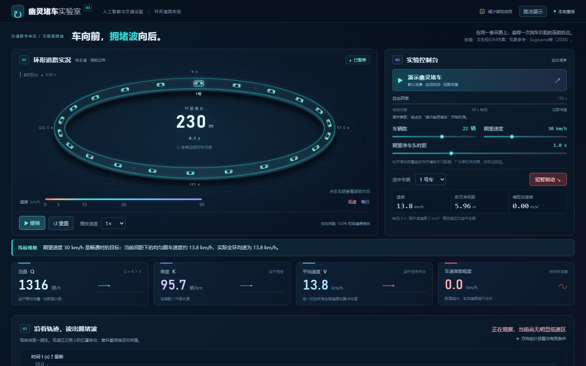

# 幽灵堵车实验室 · QKV

一个可交互的交通流小实验：没有红绿灯、事故或道路收窄，车辆在同一条环路上行驶，为什么也会形成走走停停？车辆向前开，低速区为什么可能向后传播？

**[打开在线实验](https://cunniffestumb-web.github.io/QKV/)**

## 可以做什么

- 一键演示：22辆车在230米环路上行驶，仿真第20秒短暂制动，180秒后展示观察摘要。
- 调整车辆数、期望速度和净车头时距，选择车辆并观察速度、间距与跟驰反应。
- 查看真实仿真历史生成的车辆拖尾、制动反馈和位置—时间轨迹。
- 探索流量Q、密度K、速度V，自动采样16个密度，在三张基本图间联动读数。
- 下载车辆轨迹CSV、基本图CSV和含参数、事件、轨迹及摘要的JSON。

## 运行方式

直接访问上方网址；也可以下载仓库后，用现代浏览器打开 `index.html`。计算全部在浏览器内完成，无需账号、服务器、密钥或安装依赖。阅读文献时会打开相应的外部来源。

## 模型与数据

采用同质单车道Intelligent Driver Model（IDM）。车辆位置与速度由数值积分得到，动效读取实际状态和历史。

在全环空间平均口径下，`K=N/(L/1000)`，`V`为同一时刻全环车辆速度的算术平均，`Q=KV`。单位分别为辆/km、km/h和辆/h。一个固定车辆数的环形实验具有固定全环密度；基本图的不同密度样本分别运行。

页面数据是本项目的教学仿真结果，现象依据来自Sugiyama等（2008）的环形实验。所选参数、初始条件及有限采样时长见页面展开说明。低速区传播估计使用实际历史中的环形质心，属于机制演示。

## 参考资料

1. Sugiyama, Y. et al. (2008). *Traffic jams without bottlenecks—experimental evidence for the physical mechanism of the formation of a jam.* New Journal of Physics, 10, 033001. [DOI](https://doi.org/10.1088/1367-2630/10/3/033001) · [开放全文](https://ir.library.osaka-u.ac.jp/repo/ouka/all/93262/NewJPhys_10_033001.pdf)
2. Treiber, M., Hennecke, A. & Helbing, D. (2000). *Congested traffic states in empirical observations and microscopic simulations.* Physical Review E, 62, 1805–1824. [DOI](https://doi.org/10.1103/PhysRevE.62.1805) · [作者预印本](https://arxiv.org/abs/cond-mat/0002177)
3. [IDM作者模型说明](https://traffic-simulation.de/info/info_IDM.html)

## 项目说明

《人工智能与交通运输》课程小实验。万俊鑫提出需求、选定参考与迭代方向，在Codex协助下完成三轮制作、验证和发布。本仓库保存最终网页，实验过程材料另行留存。
